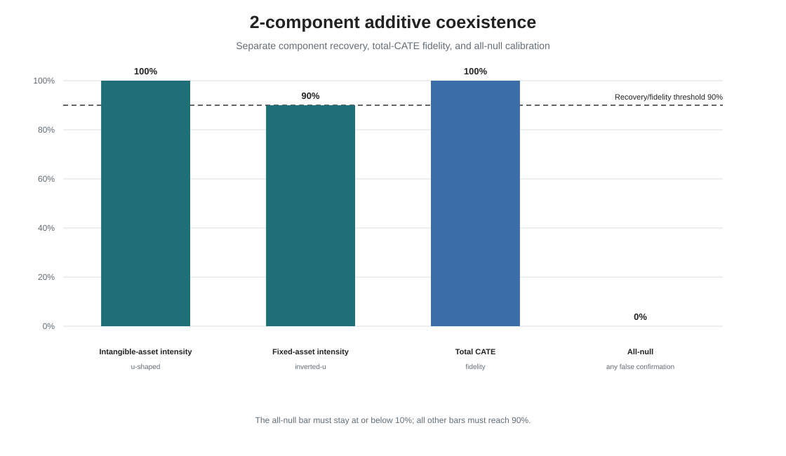
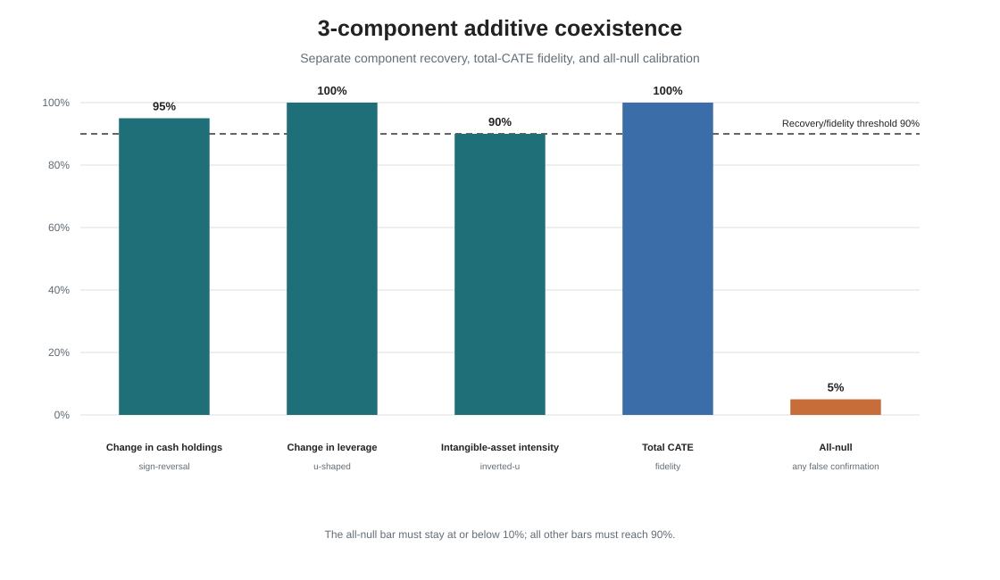

# 多情境共生探索

该模块把研究从单个企业特征的形态恢复扩展到异质性共生：两个或三个预先指定的
企业特征以加性方式共同决定同一个 CATE 面。每个数据集仍只训练一棵联合纳入
12 个候选企业特征的 `CausalForestDML`；TRAIN 负责加性重构和成分剥离，
untouched TEST 负责在控制其他成分后确认已经固定的成分。

方法问题不只是总体 CATE 是否准确，而是控制其他活动关系后，每一条组成关系是否
仍能恢复正确函数形态和关键量。因此，本模块把完整单成分标准分别施加于每个成分，
并额外检验总体 CATE fidelity 和全 null 下任一假确认概率。

整个研究属于一个共生探索模块，但两组件和三组件分开汇报：

```text
additive_coexistence/
|-- shared/                  共享方法配置
|-- src/                     共享估计和重构代码
|-- two_component/           独立配置、报告、表格、图和 manifest
`-- three_component/         独立配置、报告、表格、图和 manifest
```

## 已记录结果

| 示例 | 各成分完整恢复率 | 总 CATE fidelity | 全 null 下任一假确认率 |
|---|---:|---:|---:|
| 两组件 | 90%、100% | 100% | 0% |
| 三组件 | 95%、90%、100% | 100% | 5% |

两组件示例包括固定资产强度的倒 U 和无形资产强度的 U 型。三组件示例包括现金
持有变化的符号反转、无形资产强度的倒 U 和杠杆变化的 U 型。





一个成分只有在实践侧证据、准确形态、曲线 Spearman 不低于 `.95`、标准化 RMSE
不高于 `.20`，并且全部预设关键量同时通过时才记为成功。每个成分需要在 20 个
fresh replications 中达到 90%；总 CATE fidelity 需要达到 90%；匹配全 null 下
任一假确认率不得超过 10%。

## 分开复现

在仓库根目录运行：

```powershell
python additive_coexistence/src/run.py --config additive_coexistence/two_component/config.json
python additive_coexistence/src/run.py --config additive_coexistence/three_component/config.json
python additive_coexistence/verify.py
```

两条命令分别写入 `artifacts/` 下不同目录，并支持断点续跑。完整计算量较大，日常
CI 不重跑全部森林；CI 检查代码和配置合同，并验证全部冻结汇总证据的哈希。

GitHub Actions 会把模块证据上传为
`orgcate-additive-coexistence-<run_id>`。下载包包含综合模块报告、两组件和三组件
各自的报告、图片、汇总表、配置及 manifest，不包含企业级数据记录。

## 结论边界

这是 `n=3000` 下信号清晰、预先指定、加性且无交互的示例。它证明有限复杂度的
共生异质性可以被剥离，但不代表自动发现活跃变量，不覆盖交互效应，也不意味着
任意变量和形态组合都能成功。开发记录同时保留原始信号强度下未通过的组合，因此
这里报告的是已经证明的能力，而不是普遍保证。

详见[综合模块报告](ADDITIVE_COEXISTENCE_REPORT.zh-CN.md)、
[方法说明](METHOD.md)、[两组件报告](two_component/evidence/REPORT.zh-CN.md)
和[三组件报告](three_component/evidence/REPORT.zh-CN.md)。
