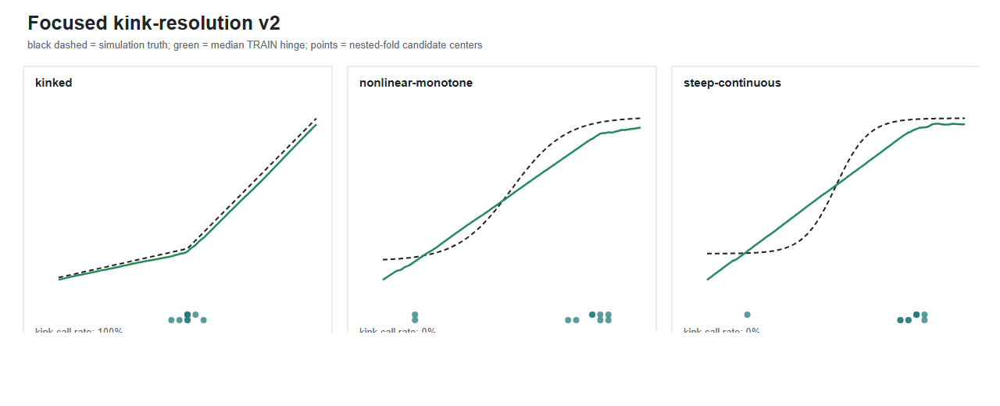

# 连续折点识别 v2

## 目的

Morphology Product v1 中，kinked 的形态准确率为 1/10，而其他主要情境已经达到
预设标准。v2 只检验 kinked，并以 nonlinear-monotone 和 steep-continuous 作为
相邻对照。

## 方法

Product v1 比较 hinge 与 tanh 的 TRAIN 预测损失。有限样本下两者可以非常接近，
导致 kinked 常被归入平滑曲线。v2 在 TRAIN 内采用五折 outer、三折 inner 的嵌套
步骤：inner folds 定位折点，outer fold 比较固定 hinge 与单一直线的正交损失。
同时要求折点位于分布内部、跨 fold/refit 稳定，并且左右斜率方向一致但大小存在
实质差异。TEST 只检验 TRAIN 选出的非恒定函数。

## 确认结果

| 情境 | kink调用率 | 分类准确率 | 候选位置中位数 | 位置误差中位数 | 左右斜率比中位数 |
|---|---:|---:|---:|---:|---:|
| kinked | 100% | 100% | 0.500 | 0.000 | 5.27 |
| nonlinear-monotone | 0% | 100% | 0.750 | 不适用 | 4.48 |
| steep-continuous | 0% | 100% | 0.738 | 不适用 | 7.68 |

黑色虚线为模拟真值，绿色实线为 10 次确认实验的 TRAIN hinge 重构中位数，横轴
下方的点为各次实验估计的折点位置。Kinked 的估计位置集中在 0.50；两个平滑
对照的 hinge 近似通常位于支持区边缘，且未通过稳定性条件。

## 结论

30 个 cell 全部完成。Kinked 在 10/10 中被识别，两个平滑对照均为 0/10 假阳性，
折点位置误差中位数为 0。该结果适用于本实验定义和 `n=3000` 的样本条件；尚未
检验其他折点强度、位置或样本量。
