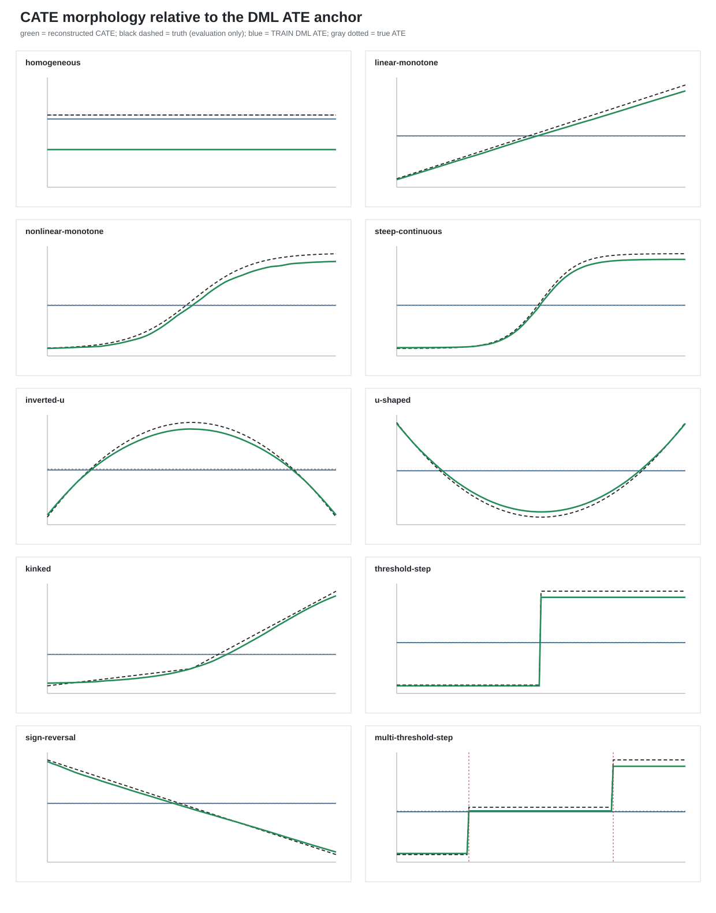
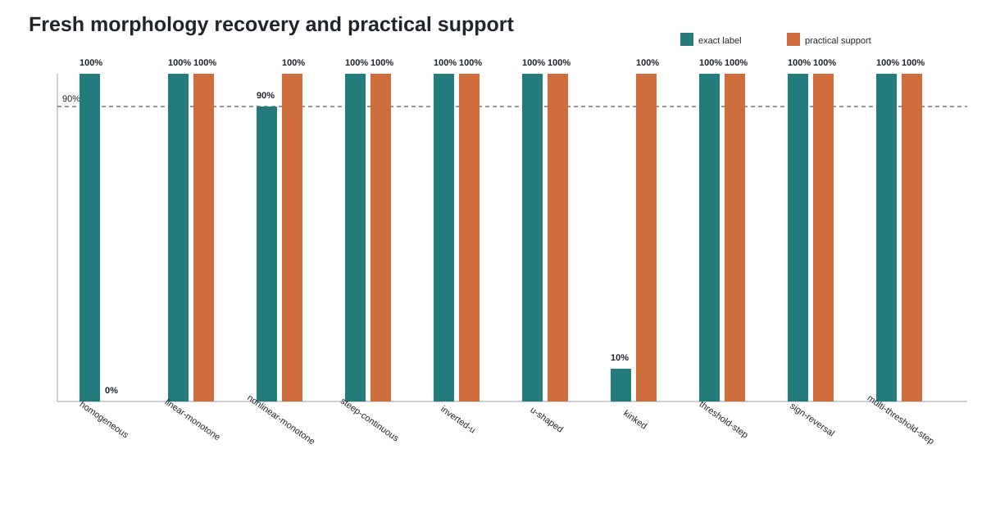
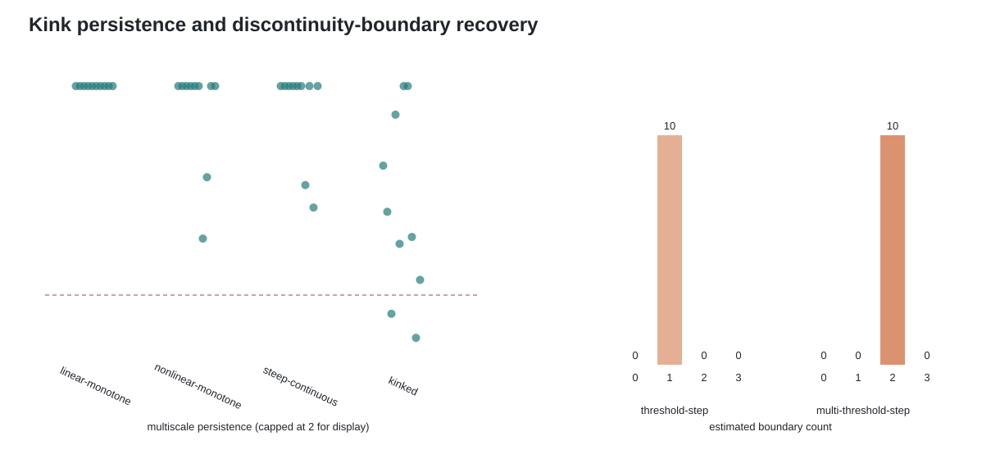

# Morphology Product v1：确认实验结果

## 研究设计

每个 replication 在 TRAIN 样本上完成以下估计：五折 cross-fitted DML/AIPW
估计 ATE；一棵包含 12 个企业特征的 honest `CausalForestDML` 估计 CATE；沿预先
指定的焦点企业特征重构效应函数。TEST 样本用于比较所选函数与恒定效应模型。
变量重要性排名作为描述性结果，不参与函数形态选择。

确认实验包含 10 个 DGP，每个 DGP 运行 10 次，共 100 个 cell。每个 cell 使用
`n=3000` 和一个 80% TRAIN / 20% TEST 划分。

## 结果

| DGP | 形态准确率 | TEST确认率 | CATE排序相关中位数 | DML ATE绝对误差中位数 | 边界数中位数 |
|---|---:|---:|---:|---:|---:|
| homogeneous | 100% | 0% | 不适用 | 0.044 | 0.0 |
| linear-monotone | 100% | 100% | 1.000 | 0.053 | 0.0 |
| nonlinear-monotone | 90% | 100% | 1.000 | 0.046 | 0.0 |
| steep-continuous | 100% | 100% | 1.000 | 0.049 | 0.0 |
| inverted-u | 100% | 100% | 1.000 | 0.054 | 0.0 |
| u-shaped | 100% | 100% | 1.000 | 0.027 | 0.0 |
| kinked | 10% | 100% | 1.000 | 0.052 | 0.0 |
| threshold-step | 100% | 100% | 1.000 | 0.048 | 1.0 |
| sign-reversal | 100% | 100% | 1.000 | 0.043 | 0.0 |
| multi-threshold-step | 100% | 100% | 1.000 | 0.046 | 2.0 |

每个比例的分母为 10；例如 90% 表示本次确认实验中有 9 次正确分类。

## 图 1：CATE 与 ATE

绿色实线和区间分别为 10 次 replication 的重构 CATE 中位数和 10%–90% 区间；
蓝线和浅蓝区间为 DML ATE 及置信区间；黑色虚线和灰色点线为模拟真值。各面板
显示 ATE 未能表示的效应排序、转折、平台和符号变化，以及重构曲线对这些特征的
恢复程度。

## 图 2：形态恢复与 TEST 确认

青色柱表示形态标签正确率，橙色柱表示所选非恒定函数通过 TEST 比较的比例。
Kinked 的 TEST 确认率为 100%，但形态标签正确率只有 10%，表明主要问题出现在
折点与相近平滑曲线的区分，而不是异质性本身的检出。

## 图 3：折点和多边界

左图比较不同局部窗口下的斜率变化；右图给出单阈值与多阈值 DGP 中恢复的边界
数量。多阈值情境在 10 次 replication 中均恢复出两个边界。

## 验收结果

100 个 cell 全部完成。Homogeneous 情境没有产生非恒定效应支持；
linear-monotone、nonlinear-monotone 和 steep-continuous 均未被误判为 kinked；
multi-threshold-step 在 10/10 中恢复两个边界，边界位置误差中位数为 0。

DML ATE 的平均误差为 0.0012，平均绝对误差约 0.05，95% 置信区间覆盖率为
94/100。除 kinked 外，其余高层形态均达到至少 9/10 的预设标准。

Kinked 只有 1/10 被正确命名，但其余信息恢复较好：焦点变量在 10/10 中排名
第一，CATE 排序相关均为 1.000，非恒定效应均通过 TEST 比较，估计折点集中在
0.475–0.525，真实位置为 0.50。误差来自 hinge 与平滑 tanh 的函数选择。因此，
Product v1 的总体验收未通过，折点识别另行开展 v2 实验；本报告保留原结果。
