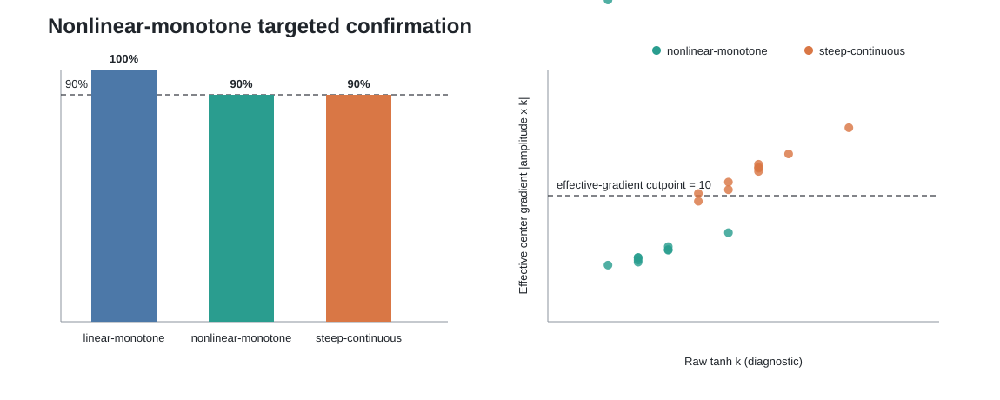

# Nonlinear-monotone targeted fresh confirmation v1

## 方法修正

主森林、DGP、12个候选特征和80/20划分均未改变。TRAIN仍通过三次五折交叉拟合
nuisance residual重构tanh曲线。形态的剧烈程度改由实际中心梯度
`|amplitude x k|`判断；关键量为中心、振幅和25%-75%中央过渡宽度。裸`k`继续
报告，但不再单独决定恢复是否成功。untouched TEST只确认固定候选相对常数效应。

## Fresh结果

| 情境 | 形态正确 | 盲态证据 | 曲线准确 | 关键量准确 | 统一成功 | 裸k诊断准确 |
|---|---:|---:|---:|---:|---:|---:|
| linear-monotone | 100% | 100% | 100% | 100% | **100%** | 100% |
| nonlinear-monotone | 90% | 100% | 100% | 90% | **90%** | 70% |
| steep-continuous | 90% | 100% | 100% | 100% | **90%** | 80% |

左图是唯一对外成功率，虚线为90%门槛。右图说明为什么不再用裸`k`定义剧烈
程度：横轴`k`会随振幅补偿而移动，纵轴有效梯度直接表示CATE在中心变化多快。

## 审计边界

本轮规则和新种子在结果前冻结。每个cell实际拟合一棵12特征、1000树的联合
`CausalForestDML`；TRAIN选择，TEST确认，oracle只在最后评分。practical文件与
evaluator文件分别保存。该结果只解决单变量普通非线性及其两个邻近对照，不授权
多变量共生结论。
