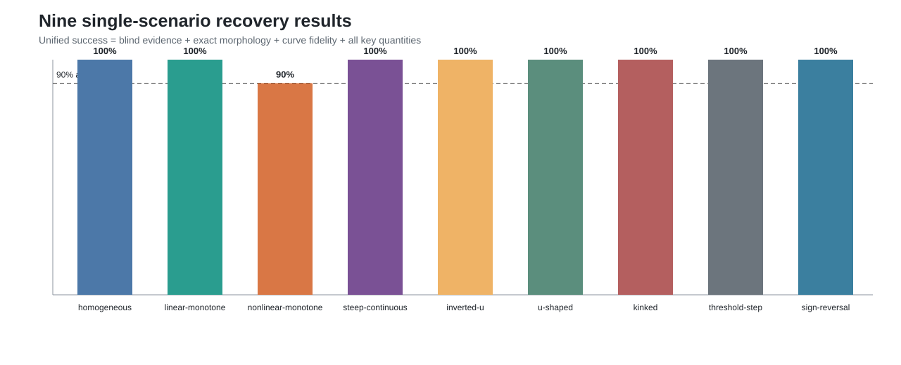

# 单情境九类统一验收结果 v1

本报告不重新拟合模型。八类沿用冻结的统一验收结果；`nonlinear-monotone`由
预冻结的新种子 targeted confirmation替换。所有类别使用同一个最终成功定义。

| 情境 | 盲态证据 | 形态正确 | 曲线准确 | 关键量准确 | 最终成功 |
|---|---:|---:|---:|---:|---:|
| homogeneous | 100% | 100% | 100% | 100% | **100%** |
| linear-monotone | 100% | 100% | 100% | 100% | **100%** |
| nonlinear-monotone | 100% | 90% | 100% | 90% | **90%** |
| steep-continuous | 100% | 100% | 100% | 100% | **100%** |
| inverted-u | 100% | 100% | 100% | 100% | **100%** |
| u-shaped | 100% | 100% | 100% | 100% | **100%** |
| kinked | 100% | 100% | 100% | 100% | **100%** |
| threshold-step | 100% | 100% | 100% | 100% | **100%** |
| sign-reversal | 100% | 100% | 100% | 100% | **100%** |

图中虚线是90%场景门槛。九类均达到门槛；`nonlinear-monotone`为9/10，其余
八类为10/10。该结果是simulation recovery证据，不表示真实数据存在可见真值。
实证使用时只能输出盲态证据状态、形态和关键量，不能输出oracle准确率。
