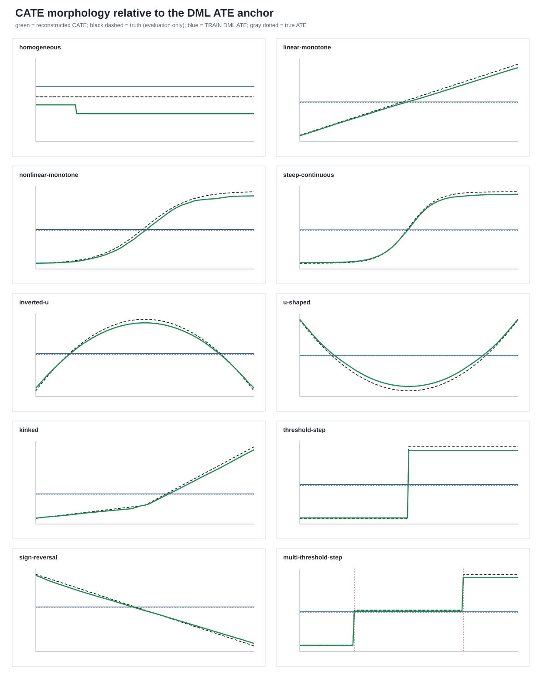
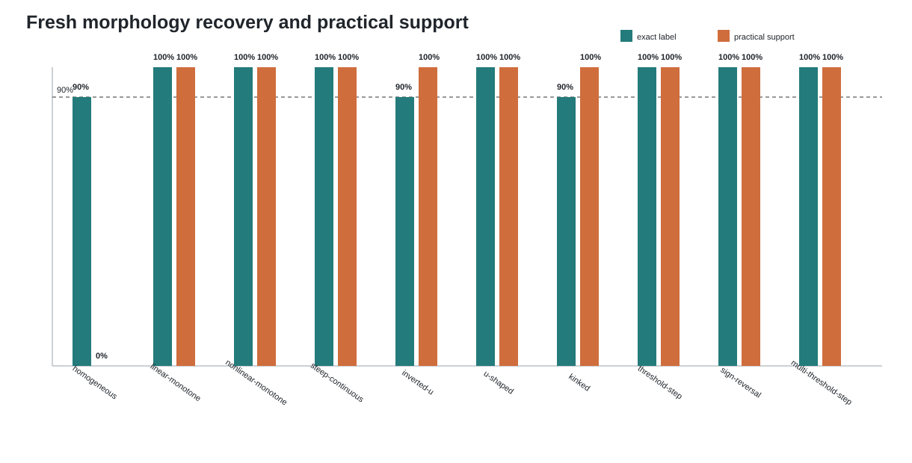
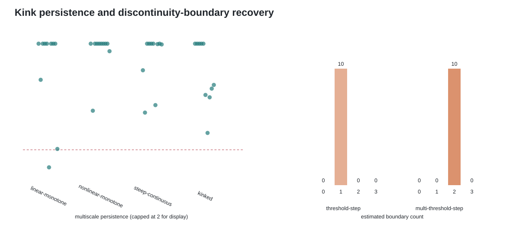

# Unified Morphology v2：100-cell fresh blind confirmation

## 研究链条

本轮把现有研究收敛为一条可审计产品链：五折 cross-fitted DML/AIPW 在 TRAIN 建立总体平均效应锚点；一棵包含 12 个企业特征的 honest `CausalForestDML` 估计 CATE；预先指定的焦点企业特征进入 TRAIN 正交形态重构；untouched TEST 只确认候选形态相对常数效应是否改善。变量重要性排名保留为信息输出，不决定是否存在异质性，也不进入形态选择。

## Fresh 结果

| DGP | 形态准确率 | 获得 practical support | CATE 曲线排序相关中位数 | TRAIN DML ATE 绝对误差中位数 | 边界数中位数 |
|---|---:|---:|---:|---:|---:|
| homogeneous | 90% | 0% | nan | 0.030 | 0.0 |
| linear-monotone | 100% | 100% | 1.000 | 0.024 | 0.0 |
| nonlinear-monotone | 100% | 100% | 1.000 | 0.030 | 0.0 |
| steep-continuous | 100% | 100% | 1.000 | 0.028 | 0.0 |
| inverted-u | 90% | 100% | 1.000 | 0.055 | 0.0 |
| u-shaped | 100% | 100% | 1.000 | 0.020 | 0.0 |
| kinked | 90% | 100% | 1.000 | 0.033 | 0.0 |
| threshold-step | 100% | 100% | 1.000 | 0.041 | 1.0 |
| multi-threshold-step | 100% | 100% | 1.000 | 0.028 | 2.0 |
| sign-reversal | 100% | 100% | 1.000 | 0.032 | 0.0 |

注意：每个比例的分母只有 10，因此 90% 表示本轮观察到 9/10，不是对总体成功概率的精确证明。

## 统一验收结果

“统一恢复”要求四项在同一次 replication 中同时成立：盲态证据成立、形态名称正确、曲线排序与幅度达标、该形态的全部关键参数达标。

| 情境 | 盲态证据 | 精确形态 | 曲线 fidelity | 关键参数 | 统一恢复 |
|---|---:|---:|---:|---:|---:|
| homogeneous | 90% | 90% | 100% | 90% | 90% |
| linear-monotone | 100% | 100% | 100% | 100% | 100% |
| nonlinear-monotone | 100% | 100% | 100% | 100% | 100% |
| steep-continuous | 100% | 100% | 100% | 100% | 100% |
| inverted-u | 100% | 90% | 90% | 90% | 90% |
| u-shaped | 100% | 100% | 100% | 100% | 100% |
| kinked | 100% | 90% | 100% | 90% | 90% |
| threshold-step | 100% | 100% | 100% | 100% | 100% |
| sign-reversal | 100% | 100% | 100% | 100% | 100% |

九类均达到预先规定的 90% 门槛；每类均完整运行 10 次。多阶梯子型另有 10 次运行，10/10 恢复两个边界，不重复计入九类通过率。

## 图 1：CATE 相对 ATE



绿色线是 practical TRAIN 重构的 CATE，中间绿色带是 10 个 fresh replications 的 10%–90% 区间；蓝线与浅蓝带是 TRAIN DML ATE 及其置信区间；黑虚线和灰点线分别是真实 CATE 与真实 ATE，只用于 simulation evaluation。图直接显示平均效应会遮蔽哪些企业间差异，以及形态重构是否找回方向、转折、折点或平台。

## 图 2：形态恢复与 practical state



青色是高层形态标签准确率，橙色是同时通过 untouched-TEST 确认并达到稳定性要求的比例。两者不同，意味着“分类正确”与“证据足以形成理论候选”是两道独立门槛。

## 图 3：折点与多边界诊断



左图检查斜率变化在不同局部窗口缩小时是否持续存在，用来把真正连续折点与平滑弯曲区分开；右图显示单阈值和多阈值 DGP 中恢复出的边界数量。该图回答的是关键信息恢复，不把多阶梯另立为第十个高层形态。

## 运行合同审计

```json
{
  "all_high_level_at_least_9_of_10": true,
  "high_level_rates": {
    "homogeneous": 0.9,
    "inverted-u": 0.9,
    "kinked": 0.9,
    "linear-monotone": 1.0,
    "nonlinear-monotone": 1.0,
    "sign-reversal": 1.0,
    "steep-continuous": 1.0,
    "threshold-step": 1.0,
    "u-shaped": 1.0
  },
  "adjacent_false_kink_count": 0,
  "adjacent_false_kink_at_most_1_of_30": true,
  "homogeneous_false_support_count": 0,
  "homogeneous_false_support_zero": true,
  "multi_step_two_boundary_count": 10,
  "multi_step_two_boundary_at_least_9_of_10": true
}
```

## 结果解释

本轮通过已知真值的 simulation confirmation，检验实现链对预先定义形态及关键参数的恢复能力。实际研究沿用相同的估计与确认流程，并由研究者结合构念含义、机制论证和既有文献完成理论解释。
